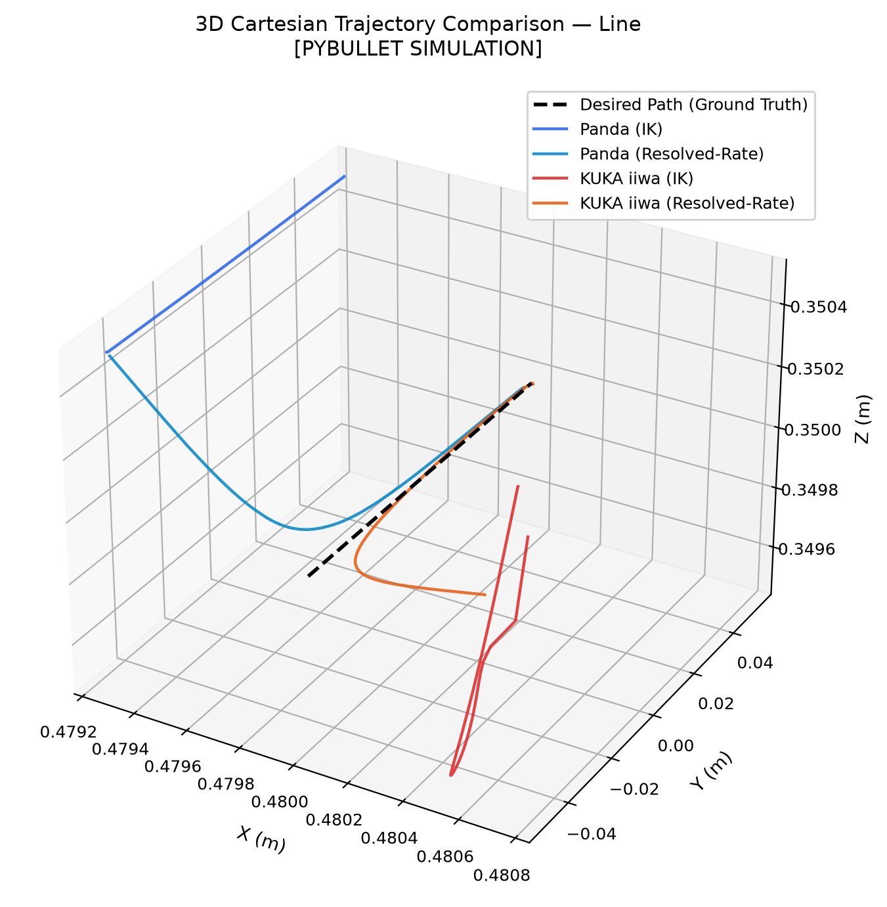
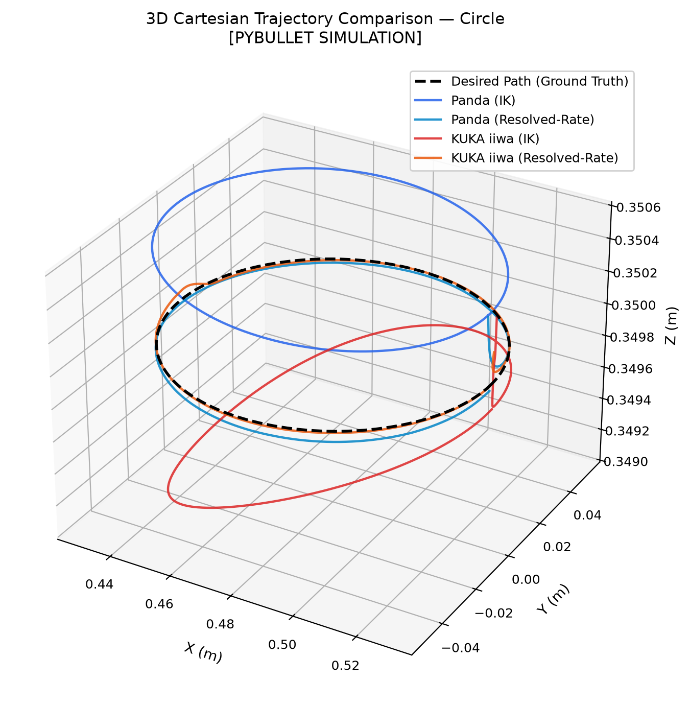
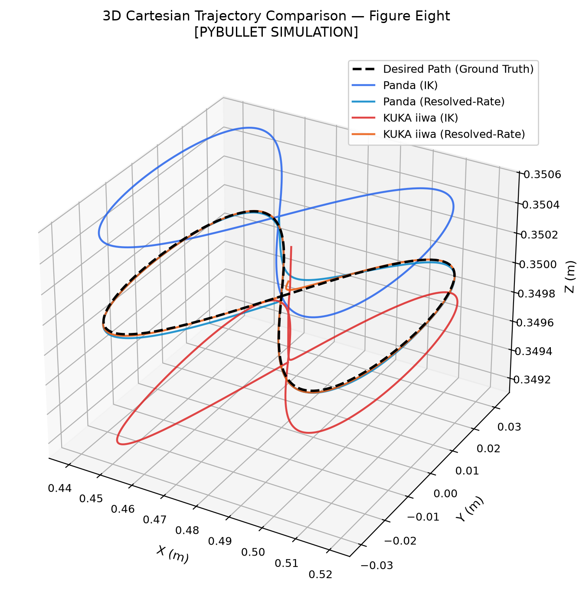
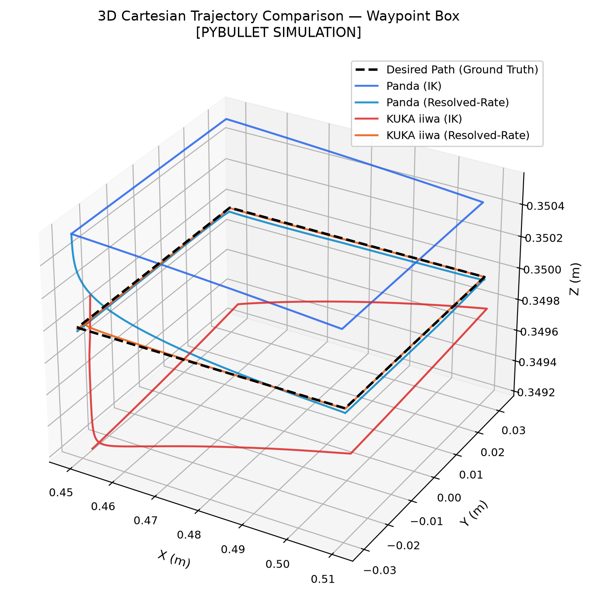
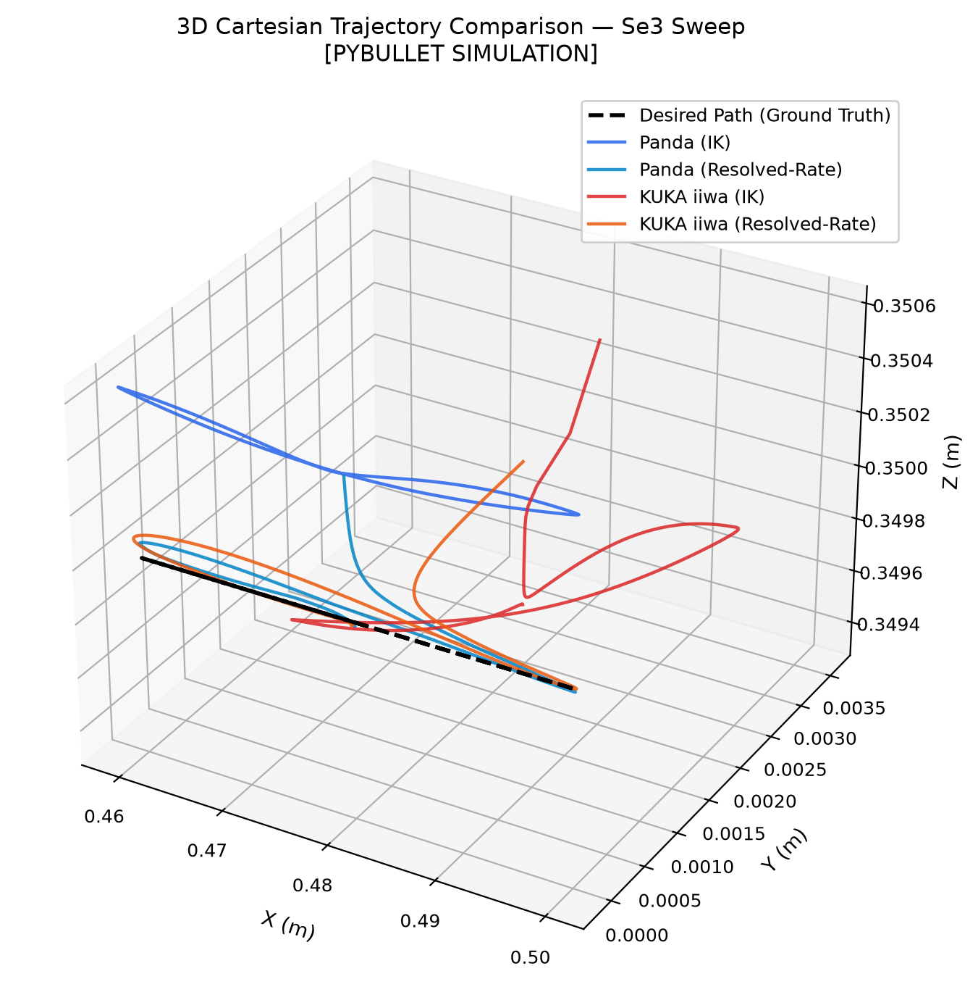
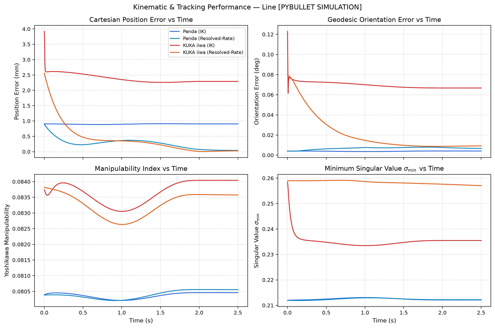
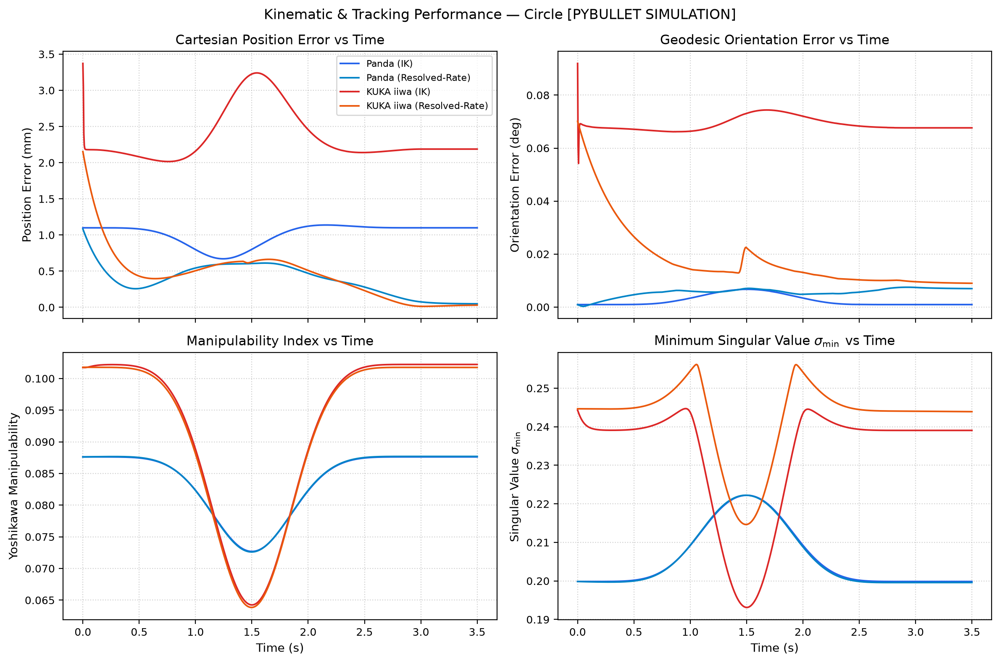
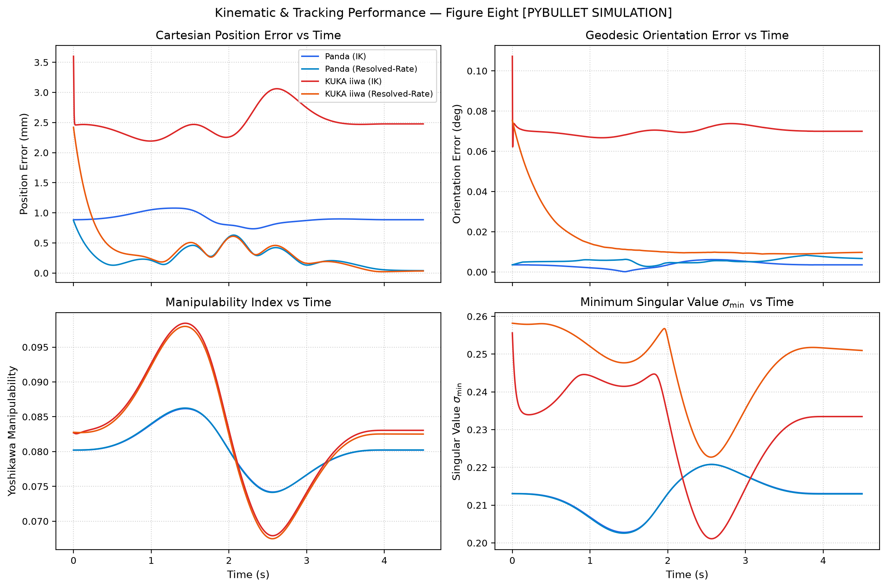
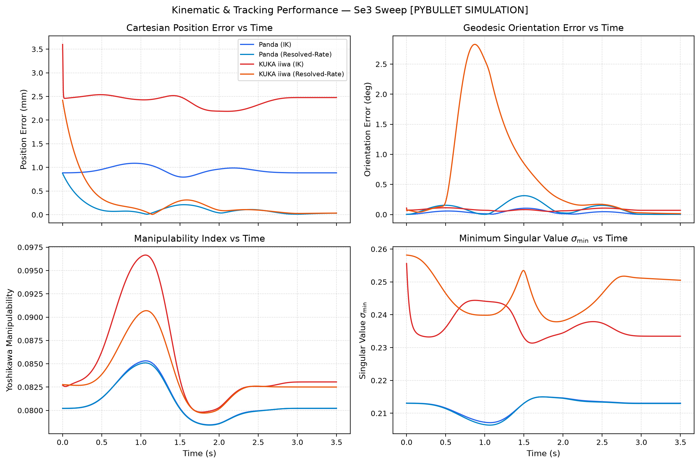
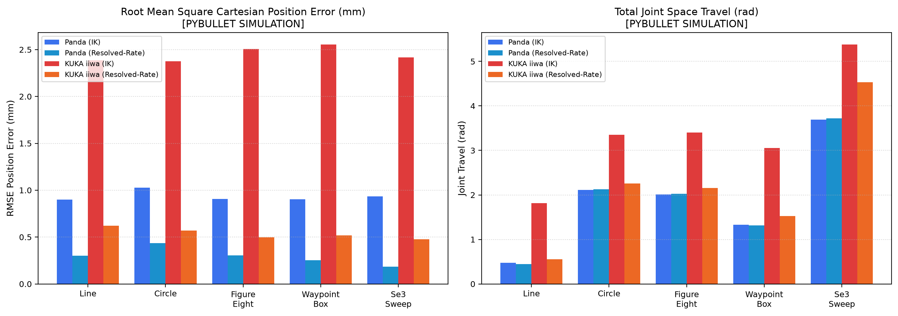

# VisionRobotTwin Task-Space Benchmark Experiment Report

> **Working-tree validation, 13 October 2026.** The commit below is the base HEAD; the tested code includes uncommitted hardening changes. See `manifest.json` for the dirty flag and runtime-source SHA-256, and [the hardening report](../../status/2026-10-13-software-hardening.md) for validation scope and remaining limits.

> [!NOTE]
> **REFERENCE PYBULLET SIMULATION RESULTS**<br>
> Generated: 2026-10-13T15:52:10.904865+00:00 UTC<br>
> Software Version: 1.3.0-dev | Commit: `7ea68db110adf503908d0a88df806831785f80a4`<br>
> Physics Engine: PyBullet package `3.2.7` (API: `202010061`) (`DIRECT` mode, fixed timestep dt = 0.004167s / 240 Hz)<br>

---

## 1. Executive Summary & Objective

This benchmark suite provides a mathematically rigorous, reproducible experimental comparison of:
1. **Manipulators**: Franka Emika Panda (7-DoF) vs KUKA LBR iiwa (7-DoF).
2. **Controllers**: IK position control with coordinated joint velocity limits vs Resolved-Rate Jacobian differential velocity control with damping.
3. **Trajectories**: Identical deterministic Cartesian task-space trajectories executed under strictly matching physical simulation parameters.
4. **Motion Planning**: Obstacle-blocked Cartesian reachability comparing direct joint-space interpolation against RRT-Connect planning and shortcutting.

## 2. Environment & Simulation Parameters

| Parameter | Value | Details |
| :--- | :--- | :--- |
| **OS** | `Windows` | 10.0.26300 |
| **Python** | `3.12.10` | CPython |
| **NumPy** | `2.2.6` | Vectorized linear algebra |
| **PyBullet Package** | `3.2.7` | Physics client `DIRECT` |
| **PyBullet API** | `202010061` | Internal C API version |
| **Physics Frequency** | `240 Hz` | `dt = 0.004167s` |
| **Settle Tolerance** | `5.0 mm` | Settled final position threshold |
| **Success Position Tolerance** | `10.0 mm` | Trial completion position threshold |
| **Success Orientation Tolerance** | `10.0 deg` | Trial completion orientation threshold |
| **Planning Position Tolerance** | `25.0 mm` | Obstacle reach final endpoint threshold |
| **Deterministic Repeats** | `3` | Deterministic repeatability executions |
| **Random Seed** | `42` | Deterministic initialization seed |

## 3. Shared Feasibility Preflight

Before executing any trajectory trial, the entire desired task-space curve is sampled at dense intervals. Both Franka Emika Panda and KUKA LBR iiwa solvers verify that inverse kinematics solutions exist with Cartesian position residual $\le 25\text{ mm}$ and orientation error $\le 10^\circ$ across every checked waypoint.

| Trajectory | Shared Feasible | Panda Feasible | KUKA Feasible | Checked Samples | Total Samples | Stride | Max Pos Residual (mm) | Max Orn Residual (deg) | Policy |
| :--- | :---: | :---: | :---: | :---: | :---: | :---: | :---: | :---: | :--- |
| `line` | **PASS** | PASS | PASS | 481 | 481 | 1 | 2.60 mm | 0.08° | `EXACT_PATH` |
| `circle` | **PASS** | PASS | PASS | 721 | 721 | 1 | 2.88 mm | 0.08° | `EXACT_PATH` |
| `figure_eight` | **PASS** | PASS | PASS | 961 | 961 | 1 | 2.80 mm | 0.08° | `EXACT_PATH` |
| `waypoint_box` | **PASS** | PASS | PASS | 961 | 961 | 1 | 2.77 mm | 0.08° | `EXACT_PATH` |
| `se3_sweep` | **PASS** | PASS | PASS | 721 | 721 | 1 | 2.47 mm | 0.08° | `EXACT_PATH` |

Every generated trajectory sample was checked during preflight verification (`preflight_sample_stride = 1`).

## 4. Task Definitions

1. **LINE**: Straight 10 cm horizontal Cartesian translation with fixed orientation.
   - Center Position: `[0.48, 0.0, 0.35]`
   - Geometry: `{'length_m': 0.1, 'axis': 'Y', 'path_type': 'Straight Cartesian Line'}`
   - Duration: `2.0 s` (481 samples @ 240 Hz)
   - Orientation Profile: `Fixed downward [1, 0, 0, 0]` (Rotation Axis: `None (Fixed)`)

2. **CIRCLE**: Continuous horizontal task-space circle (R = 5 cm) with fixed orientation.
   - Center Position: `[0.48, 0.0, 0.35]`
   - Geometry: `{'radius_m': 0.05, 'plane': 'XY', 'path_type': 'Continuous Planar Circle'}`
   - Duration: `3.0 s` (721 samples @ 240 Hz)
   - Orientation Profile: `Fixed downward [1, 0, 0, 0]` (Rotation Axis: `None (Fixed)`)

3. **FIGURE_EIGHT**: Lemniscate figure-eight trajectory (X peak amplitude: 4 cm, Y peak amplitude: 3 cm).
   - Center Position: `[0.48, 0.0, 0.35]`
   - Geometry: `{'amplitude_x_m': 0.04, 'amplitude_y_m': 0.03, 'plane': 'XY', 'path_type': 'Lemniscate (Figure-Eight)'}`
   - Duration: `4.0 s` (961 samples @ 240 Hz)
   - Orientation Profile: `Fixed downward [1, 0, 0, 0]` (Rotation Axis: `None (Fixed)`)

4. **WAYPOINT_BOX**: Smooth 4-corner closed box path (6 cm x 6 cm) in the XY plane.
   - Center Position: `[0.48, 0.0, 0.35]`
   - Geometry: `{'size_x_m': 0.06, 'size_y_m': 0.06, 'plane': 'XY', 'corners': 4, 'path_type': '4-Corner Rectangular Route'}`
   - Duration: `4.0 s` (961 samples @ 240 Hz)
   - Orientation Profile: `Fixed downward [1, 0, 0, 0]` (Rotation Axis: `None (Fixed)`)

5. **SE3_SWEEP**: 6-DoF trajectory with +/-20 deg X-axis roll rotation via quaternion SLERP and 2 cm X harmonic translation.
   - Center Position: `[0.48, 0.0, 0.35]`
   - Geometry: `{'harmonic_translation_axis': 'X', 'harmonic_amplitude_m': 0.02, 'rotation_axis': 'X', 'max_roll_deg': 20.0, 'path_type': '6-DoF Roll SLERP + Harmonic Translation'}`
   - Duration: `3.0 s` (721 samples @ 240 Hz)
   - Orientation Profile: `Quaternion SLERP roll sweep (+/-20 deg around X-axis)` (Rotation Axis: `X (Roll)`)

## 5. Cross-Robot & Cross-Controller Summary Matrix

| Experiment | Metric | Panda (IK) | Panda (Resolved-Rate) | KUKA iiwa (IK) | KUKA iiwa (Resolved-Rate) |
| :--- | :--- | :---: | :---: | :---: | :---: |
| **Line** | **RMSE Pos (mm)** | 0.90 | 0.30 | 2.38 | 0.62 |
| | **P95 Pos (mm)** | 0.91 | 0.55 | 2.61 | 1.54 |
| | **Mean Orn (deg)** | 0.00° | 0.01° | 0.07° | 0.02° |
| | **Joint Travel (rad)** | 0.48 rad | 0.45 rad | 1.81 rad | 0.56 rad |
| | **Min Manipulability** | 0.08 | 0.08 | 0.08 | 0.08 |
| | **Success Rate** | **100%** | **100%** | **100%** | **100%** |
| **Circle** | **RMSE Pos (mm)** | 1.03 | 0.43 | 2.37 | 0.57 |
| | **P95 Pos (mm)** | 1.13 | 0.61 | 3.18 | 1.07 |
| | **Mean Orn (deg)** | 0.00° | 0.01° | 0.07° | 0.02° |
| | **Joint Travel (rad)** | 2.12 rad | 2.13 rad | 3.35 rad | 2.26 rad |
| | **Min Manipulability** | 0.07 | 0.07 | 0.06 | 0.06 |
| | **Success Rate** | **100%** | **100%** | **100%** | **100%** |
| **Figure Eight** | **RMSE Pos (mm)** | 0.91 | 0.31 | 2.51 | 0.50 |
| | **P95 Pos (mm)** | 1.07 | 0.60 | 3.01 | 0.98 |
| | **Mean Orn (deg)** | 0.00° | 0.01° | 0.07° | 0.02° |
| | **Joint Travel (rad)** | 2.01 rad | 2.03 rad | 3.40 rad | 2.15 rad |
| | **Min Manipulability** | 0.07 | 0.07 | 0.07 | 0.07 |
| | **Success Rate** | **100%** | **100%** | **100%** | **100%** |
| **Waypoint Box** | **RMSE Pos (mm)** | 0.90 | 0.25 | 2.55 | 0.52 |
| | **P95 Pos (mm)** | 1.05 | 0.39 | 2.91 | 1.13 |
| | **Mean Orn (deg)** | 0.00° | 0.01° | 0.07° | 0.02° |
| | **Joint Travel (rad)** | 1.33 rad | 1.32 rad | 3.05 rad | 1.52 rad |
| | **Min Manipulability** | 0.08 | 0.08 | 0.07 | 0.07 |
| | **Success Rate** | **100%** | **100%** | **100%** | **100%** |
| **Se3 Sweep** | **RMSE Pos (mm)** | 0.94 | 0.19 | 2.42 | 0.48 |
| | **P95 Pos (mm)** | 1.08 | 0.43 | 2.53 | 1.18 |
| | **Mean Orn (deg)** | 0.03° | 0.10° | 0.08° | 0.64° |
| | **Joint Travel (rad)** | 3.69 rad | 3.72 rad | 5.38 rad | 4.53 rad |
| | **Min Manipulability** | 0.08 | 0.08 | 0.08 | 0.08 |
| | **Success Rate** | **100%** | **100%** | **100%** | **100%** |

## 6. Visual Evidence & Trajectory Comparisons

### Trajectory 3D Comparison Line


### Trajectory 3D Comparison Circle


### Trajectory 3D Comparison Figure Eight


### Trajectory 3D Comparison Waypoint Box


### Trajectory 3D Comparison Se3 Sweep


### Telemetry Timeseries Line


### Telemetry Timeseries Circle


### Telemetry Timeseries Figure Eight


### Telemetry Timeseries Se3 Sweep


### Summary Benchmarks Comparison


## 7. Obstacle-Blocked Motion Planning Experiment

A dedicated obstacle avoidance experiment tests the complete collision-aware planning stack when moving between points $[0.42, -0.18, 0.35]$ and $[0.42, 0.18, 0.35]$ separated by a rigid box obstacle at $[0.42, 0.0, 0.35]$.

Under this PyBullet configuration, planning PASS requires collision-free trajectory execution AND a final endpoint error $\le 25.0\text{ mm}$. This criterion validates high-level obstacle clearing and endpoint arrival, distinct from the 5.0 mm continuous settled tracking tolerance.

| Robot | Direct Path State | RRT-Connect Status | Plan Time (ms) | Raw Waypoints | Smoothed Waypoints | Raw Travel (rad) | Smoothed Travel (rad) | Min Clearance (m) | Execution | Final Error (mm) |
| :--- | :---: | :---: | :---: | :---: | :---: | :---: | :---: | :---: | :---: | :---: |
| **PANDA** | `BLOCKED` | `SUCCESS` | 1040.0 ms | 50 | 14 | 2.39 rad | 1.70 rad | 0.0026 m | **PASS** | 1.00 mm |
| **KUKA_IIWA** | `BLOCKED` | `SUCCESS` | 573.1 ms | 36 | 4 | 1.70 rad | 1.30 rad | 0.0056 m | **PASS** | 1.42 mm |

## 8. Failure Cases & Singularity Telemetry

- **Feasibility**: 5 shared-feasible trajectories verified, 0 failed feasibility preflight trajectories.
- **Trial Execution**: 60 executed trials (60 successful, 0 failed), 0 skipped trials due to preflight gating.
- **Collisions**: Recorded 0 self-collisions and 0 environment-collisions across all executed trials.
- **Singularity Warnings**: 0 total near-singularity warning steps (condition number $> 100$ or $\sigma_{\min} < 0.01$) observed during execution.
- **Joint Limit Events**: 0 joint-limit violations observed during execution.

## 9. Limitations & Conservative Interpretation

> [!WARNING]
> **Experimental Scope & Limitations:**
> - All results reported herein were gathered strictly inside **PyBullet physics simulation** under idealized rigid-body dynamics.
> - No claim is made regarding physical hardware performance, motor thermal limits, gear backlash, or physical friction non-linearities.
> - Kinematic and controller comparisons reflect the specific URDF models, joint limits, and damping parameters configured in this environment.

## 10. Reproduction Commands

To reproduce the complete benchmark run deterministically:
```bash
python tools/run_taskspace_experiments.py --all --repeats 3 --headless
```

To run individual trajectories:
```bash
python tools/run_taskspace_experiments.py --experiment line --headless
python tools/run_taskspace_experiments.py --experiment circle --headless
python tools/run_taskspace_experiments.py --robot panda --controller ik --all --headless
```
