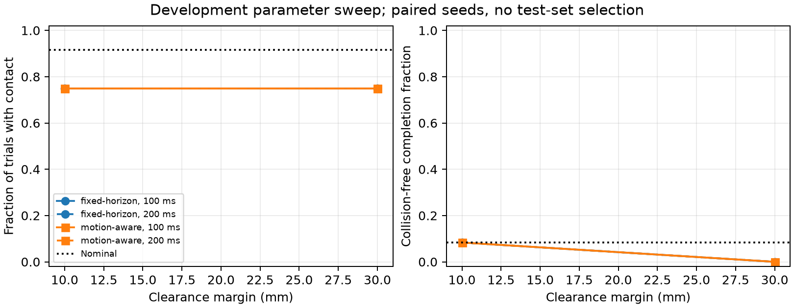

# Paired baseline parameter sweep

Completed 324/324 trials; errors: 0.

| Cell | Horizon (ms) | Margin (mm) | Completed | Collision trials | Safe completions | Mean intervention |
|---|---:|---:|---:|---:|---:|---:|
| fixed-horizon-h0-m0 | 100 | 10 | 36/36 | 27 | 3 | 0.5828703703703705 |
| fixed-horizon-h0-m1 | 100 | 30 | 36/36 | 27 | 0 | 0.6763888888888888 |
| fixed-horizon-h1-m0 | 200 | 10 | 36/36 | 27 | 3 | 0.5898148148148148 |
| fixed-horizon-h1-m1 | 200 | 30 | 36/36 | 27 | 0 | 0.6791666666666667 |
| motion-aware-h0-m0 | 100 | 10 | 36/36 | 27 | 3 | 0.6296296296296297 |
| motion-aware-h0-m1 | 100 | 30 | 36/36 | 27 | 0 | 0.7226851851851852 |
| motion-aware-h1-m0 | 200 | 10 | 36/36 | 27 | 3 | 0.6638888888888889 |
| motion-aware-h1-m1 | 200 | 30 | 36/36 | 27 | 0 | 0.7550925925925925 |
| nominal | 100 | 20 | 36/36 | 33 | 3 | 0.0 |

Development-only exploratory results. Errors are not counted as collision-free successes.
Incomplete cells cannot enter paired/Pareto analysis. No test-set setting is selected.
Contact-onset policy state does not prove that the plant was stationary: commands and stops are delayed.
Seed-cluster bootstrap intervals are descriptive and weak with only a few seeds.
Concurrent-worker timing is diagnostic, not an end-to-end real-time benchmark.

## Endpoint audit: important benchmark limitation

The exact target configurations in `kuka_iiwa/narrow-passage-v1` and
`xarm6/narrow-passage-v1` intersect static fixtures. The original v1 scenes and
all 324 trial results remain unchanged. This audit does not prove that their
entire goal tolerance regions are impossible, or that other cases have a feasible
dynamic path. Treat it as an endpoint design warning, not a feasibility theorem.

In the post-hoc subset with static-geometry-free exact targets (30 paired cases
per cell), **all methods have 27 contact trials**. Ten-millimeter stop policies
and nominal control each have 3 collision-free completions; 30 mm stop policies
have none. Thus the apparent 33-to-27 contact-trial reduction in the full grid
comes entirely from refusing contact in the two flagged narrow-passage targets.
It does not establish improved dynamic obstacle avoidance. Do not report the
post-hoc subset as a newly selected primary test set.

All motion-aware contact onsets occur while policy HOLD is requested; frozen
10 mm contact onsets occur during TRACK. This supports investigating anticipation
and stopping behavior but does not prove the plant was stationary or contact
unavoidable. Commands/stops are delayed. No policy query/estimator failure was
found in the decision-log audit.

Only three independent sensing seed clusters were used. Some count differences
are identical across seeds and bootstrap intervals collapse; this is not certainty
about unseen scenes. All figures below include the original v1 cases, including
flagged exact targets. The exploratory Pareto set is not a selected final method.

## Reproduction and artifacts

Run `python tools/sweep_research_baselines.py --workers 3 --plot --output-dir experiments/baseline-sweep-reproduction`, then
`python tools/assess_sweep_feasibility.py --sweep-dir experiments/baseline-sweep-reproduction`.
Output must be new/empty. [Protocol](../../research/BASELINE_SWEEP.md).

The sweep completed with exit code 0. All successful trial manifests share one
source snapshot based on dirty source at commit 4227b62. The retained central
manifest contains code hashes, complete dimensions, seed sets and resolved scenes;
`results.json`/`trial-metrics.csv` preserve all 324 summaries and trial source hashes.
Raw traces/decisions/per-trial manifests remain in ignored local
`experiments/baseline-sweep-v1/` and are regenerable. The endpoint audit has separate
source provenance and links to the original sweep manifest.

[Exportable SVG](sweep-diagnostic.svg).

Next: repair exact-goal construction in a versioned successor, preflight goals
and investigate dynamic trajectory feasibility, identify stopping behavior, and
reproduce a compatible published comparator before claiming a research advance.

Validation: 564 full regression tests passed, 7 optional skips. Fourteen sweep/analysis checks and two endpoint checks are included.
