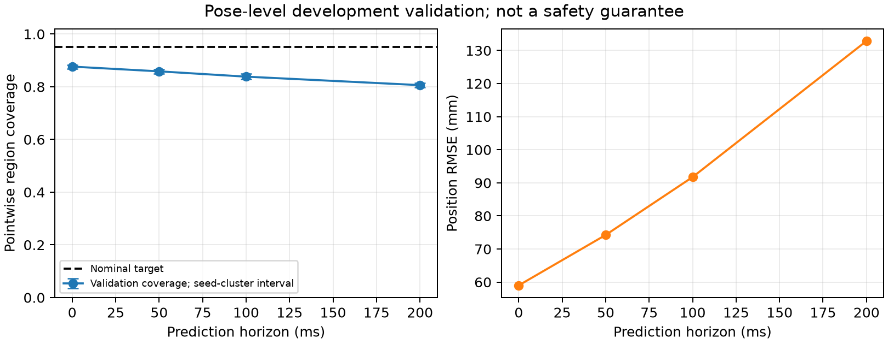

# Obstacle uncertainty diagnostic

Separate fitting and validation scenarios/seeds; validation remains part of calibration development.

| Horizon (ms) | Inflation | Raw validation coverage | Inflated validation coverage | Seed-cluster 95% interval | Position RMSE (mm) |
|---:|---:|---:|---:|---|---:|
| 0 | 1.000 | 0.876 | 0.876 | [0.869, 0.883] | 59.02 |
| 50 | 1.000 | 0.858 | 0.858 | [0.850, 0.866] | 74.25 |
| 100 | 1.000 | 0.838 | 0.838 | [0.828, 0.849] | 91.75 |
| 200 | 1.000 | 0.806 | 0.806 | [0.797, 0.815] | 132.86 |

Coverage is a measured pointwise diagnostic, not a collision or trajectory-level safety guarantee.
Scales are fitted exclusively on fitting frames; correlated frame samples do not count as independent trials.
No pass/fail is inferred from a nominal confidence target; undercoverage and distribution shift remain visible.

## Protocol, evidence and limitations

40 sensor-only trials: 20 fitting (two trajectories, seeds 0-9) and 20 validation
(two different trajectories, seeds 100-109). Each trial lasts 3 simulated seconds.
Scenarios sharing a seed form one bootstrap cluster, so validation has ten seed
clusters rather than twenty independent trials. These are fixed trajectory
families, not random draws from all possible deployment scenes.

All fitted covariance inflation factors are 1.0. Undercoverage on validation is
preserved and no scaling has been installed in robot safety constraints. The
current estimator has not demonstrated its nominal 95% coverage under this shift.
Changing the fitting method after examining validation requires a new untouched
validation set before claiming independent evidence.

The release calibration CLI exited 0. Full regression: 535 passed, 7 optional
skips. Sixteen calibration tests cover replay, disjoint data, forecast availability,
occlusion, prediction/update separation, analytic score inflation, grouped
bootstrap behavior, invalid inputs, output preservation and source manifests.

Raw fitting/validation score CSVs remain under local ignored
`experiments/obstacle-calibration-v1/`. The manifest embeds resolved scenarios,
seed sets, estimator settings, source hashes and environment, recording dirty
source based on commit 8da310e. Reproduce with the command in
[the calibration guide](../../research/UNCERTAINTY_CALIBRATION.md).

[Exportable SVG figure](coverage-diagnostic.svg).
