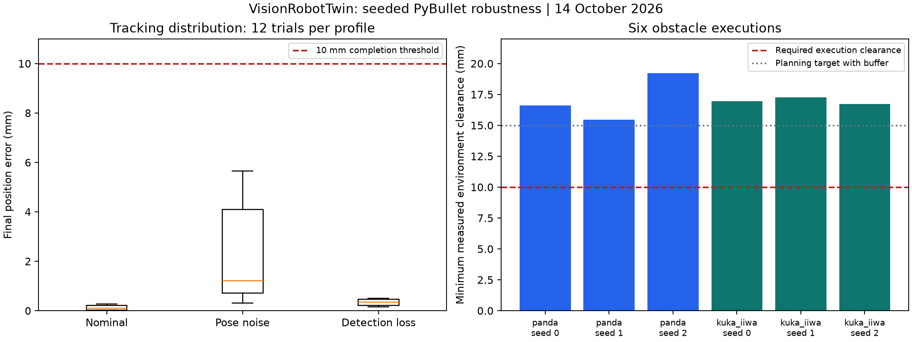

# Seeded simulation robustness report

> Local working-tree evidence based on `d09bfe4`; see the manifest for the actual runtime-source hash. The base commit passed ROS2 CI; subsequent commit-level results are available in GitHub Actions.

Pose-level sensing and simulated transport faults; no physical camera or hardware evidence.

Completed: 84/84; expected outcomes passed: 84; errors: 0.

Tracking requires both final position and orientation tolerances. Expected fault stops are assessed separately from tracking success. Fault trials must latch the specified fault, block a subsequent command, attempt halt, and finish below 0.05 rad/s with no collision/clearance or joint-limit events.

| Robot/controller/profile | Outcomes | Tracking | Final error mean / P95 (mm) |
|---|---:|---:|---:|
| panda/ik/nominal | 3/3 | 3/3 | 0.25 / 0.26 |
| panda/ik/pose_noise | 3/3 | 3/3 | 3.61 / 5.06 |
| panda/ik/detection_dropout | 3/3 | 3/3 | 0.25 / 0.26 |
| panda/ik/stale_telemetry | 3/3 | expected stop | 39.80 / 41.90 |
| panda/ik/transport_disconnect | 3/3 | expected stop | 39.80 / 41.90 |
| panda/ik/dispatch_failure | 3/3 | expected stop | 39.80 / 41.90 |
| panda/ik/command_starvation | 3/3 | expected stop | 39.67 / 41.76 |
| panda/resolved-rate/nominal | 3/3 | 3/3 | 0.03 / 0.04 |
| panda/resolved-rate/pose_noise | 3/3 | 3/3 | 0.59 / 0.72 |
| panda/resolved-rate/detection_dropout | 3/3 | 3/3 | 0.45 / 0.47 |
| panda/resolved-rate/stale_telemetry | 3/3 | expected stop | 39.27 / 41.34 |
| panda/resolved-rate/transport_disconnect | 3/3 | expected stop | 39.27 / 41.34 |
| panda/resolved-rate/dispatch_failure | 3/3 | expected stop | 39.27 / 41.34 |
| panda/resolved-rate/command_starvation | 3/3 | expected stop | 29.80 / 31.38 |
| kuka_iiwa/ik/nominal | 3/3 | 3/3 | 0.17 / 0.19 |
| kuka_iiwa/ik/pose_noise | 3/3 | 3/3 | 4.38 / 5.53 |
| kuka_iiwa/ik/detection_dropout | 3/3 | 3/3 | 0.17 / 0.19 |
| kuka_iiwa/ik/stale_telemetry | 3/3 | expected stop | 39.86 / 41.99 |
| kuka_iiwa/ik/transport_disconnect | 3/3 | expected stop | 39.86 / 41.99 |
| kuka_iiwa/ik/dispatch_failure | 3/3 | expected stop | 39.86 / 41.99 |
| kuka_iiwa/ik/command_starvation | 3/3 | expected stop | 39.74 / 41.86 |
| kuka_iiwa/resolved-rate/nominal | 3/3 | 3/3 | 0.02 / 0.02 |
| kuka_iiwa/resolved-rate/pose_noise | 3/3 | 3/3 | 0.59 / 0.73 |
| kuka_iiwa/resolved-rate/detection_dropout | 3/3 | 3/3 | 0.47 / 0.50 |
| kuka_iiwa/resolved-rate/stale_telemetry | 3/3 | expected stop | 39.39 / 41.47 |
| kuka_iiwa/resolved-rate/transport_disconnect | 3/3 | expected stop | 39.39 / 41.47 |
| kuka_iiwa/resolved-rate/dispatch_failure | 3/3 | expected stop | 39.39 / 41.47 |
| kuka_iiwa/resolved-rate/command_starvation | 3/3 | expected stop | 29.90 / 31.48 |

## Clearance planning

Required environment clearance: 10 mm; self clearance: 0 mm. Positive margins receive an additional 5 mm planning buffer and 0.02 rad path sampling; execution is checked against the requested margins.

| Robot / seed | Plan | Execution | Minimum environment / self clearance (mm) |
|---|---|---|---:|
| panda / 0 | True | True | 16.62 / 19.46 |
| panda / 1 | True | True | 15.46 / 19.48 |
| panda / 2 | True | True | 19.22 / 19.81 |
| kuka_iiwa / 0 | True | True | 16.94 / 28.90 |
| kuka_iiwa / 1 | True | True | 17.27 / 28.90 |
| kuka_iiwa / 2 | True | True | 16.71 / 28.85 |

## Limits

Gaussian noise is injected into pose targets, not camera images. Detection loss is one contiguous burst. Start joints and goal offsets vary by seed. These profiles do not model all real delays, optical failures, payloads, or loss of physical stop authority.

The guard uses deterministic simulation-time polling; real background-thread and ROS2 behavior require the separate unit and middleware suites. Planning uses discrete collision samples, not a continuous collision guarantee. Unknown/unexecuted clearances serialize as null in JSON.

See [manifest.json](manifest.json), [summary.json](summary.json), and [trials.csv](trials.csv) for configuration, source provenance, failures, and individual measurements.

The initial zero-buffer 10 mm counterexample is preserved in [clearance-counterexample.json](clearance-counterexample.json). It is historical evidence from the first implementation, not a result of the buffered policy above.
