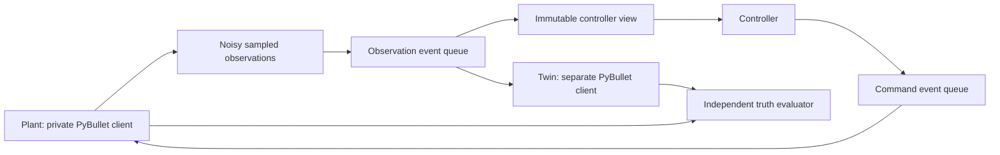

# Plant/twin testbed: first implementation

This simulation-only harness implements the first infrastructure slice of
[the roadmap](PAPER_ROADMAP.md). It is separate from the interactive application
and does not change its collision supervision. The research plant intentionally
has no truth-based safety guard so failures remain observable.

## Run

From the repository root, with the existing environment activated:

```powershell
python tools/run_plant_twin_experiment.py --robot panda --seed 0 --duration 0.5 --output-dir experiments/plant-twin-example
```

The output directory must be empty. Supported robot IDs come from the registry.
Use `--observation-delay 0.15` to change the base sensing transport delay.
Additional configuration is available through `ScenarioConfig` in Python.
The example controller is unfiltered joint-space proportional reaching using
delivered joint telemetry; it is not a collision-avoidance method or a comparison
with published methods.

## Information and timing boundaries



`controller_view()` exposes simulation time, the latest delivered observation,
DoF, and nominal velocity limits. `submit_velocity()` validates and queues a
command. Neither gives the controller plant truth. The experiment coordinator
owns the full harness; private attributes are not a security boundary.

At t, a step moves the obstacle to its scenario position, optionally captures
a noisy observation, delivers due observations, applies due commands, evaluates
the pre-integration state, and advances plant physics to t+dt. The obstacle is
updated to t+dt for terminal evaluation. Deliveries are quantized to physics
boundaries, with scheduled and actual timestamps recorded. Reordered obsolete
observations and commands are discarded by sequence ID. Queued commands cannot
be canceled in this first version.

The twin does not advance dynamically: its joints and obstacle are synchronized
only when an observation is delivered. Its initial home and obstacle origin are
common known priors, not live plant information. A future predictive filter
will need a controlled interface for twin rollouts and command history.

Joint and obstacle observation noise, dropout, transport jitter, and command
transport use seeded streams. Command scheduling cannot consume the sensor
noise RNG. Plant mass and velocity gains differ from twin values; full friction,
calibration, payload and actuator-lag models are still pending.

## Estimation and evaluation

`ConstantVelocityEstimator` filters obstacle position at capture time and
predicts to controller time. Prediction leaves its update state unchanged.
It rejects stale sequences and timestamps. Its covariance uses a declared
white-acceleration process model; it has not undergone held-out calibration and
does not constitute a confidence or safety guarantee. Joint telemetry remains
delayed rather than being silently extrapolated from truth.

The evaluator queries physical plant geometry, independently of controller
decisions. Sphere clearance and existing self/environment collision results
are logged. Contacts at adjacent samples form one episode in the summary.
This is discrete evaluation, without swept-volume or resolution-convergence
validation yet. Benign smoke runs without contacts establish no safety claim.

## Artifacts

- `trace.jsonl`: plant/twin states, observed obstacle, observation age, applied
  command sequence, collision flags, and obstacle clearance; includes terminal
  evaluation without an extra integration step.
- `events.json`: captured/dropped/delivered/stale observations and submitted/
  applied/stale commands, values, and requested/actual delivery times.
- `estimates.json`: obstacle position/velocity estimates and covariance.
- `summary.json`: event counts, sampled contact episodes, minimum clearance,
  and exact trace hash.
- `manifest.json`: configuration, dependency versions, environment, dirty-tree
  status, source file hashes and limitations.

Raw traces are stored under ignored `experiments/`; selected milestone summaries
and manifests can be retained in `docs/experiments/`. Exact deterministic replay
is checked within the current environment. Cross-platform bitwise equivalence
is not claimed. This runner currently stores records in memory and is intended
for short development trials, not large-scale evaluation.

## Remaining before G1 / comparative research

Add versioned scenario loading, explicit command expiry and stale-telemetry
fallback, independent stopping behavior, a rollout/query interface, image-based
observations, calibrated uncertainty, stronger evaluator convergence checks,
and a verified literature baseline. The first infrastructure tests do not close
G0 or establish the complete G1 research benchmark.
