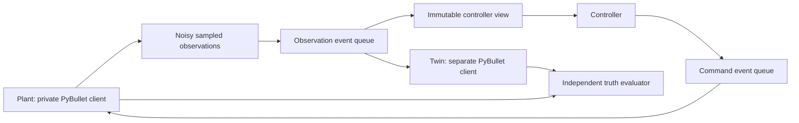

# Plant/twin testbed: first implementation

This simulation-only harness implements the first infrastructure slice of
[the roadmap](PAPER_ROADMAP.md). It is separate from the interactive application
and does not change its collision supervision. The research plant intentionally
has no truth-based safety guard so failures remain observable.

## Run

From the repository root, with the existing environment activated:

```powershell
python tools/run_plant_twin_experiment.py --robot panda --seed 0 --duration 0.5 --output-dir experiments/plant-twin-example
```

The output directory must be empty. Supported robot IDs come from the registry.
Use `--observation-delay 0.15` to change the base sensing transport delay.
Additional configuration is available through `ScenarioConfig` in Python.
The example controller is unfiltered joint-space proportional reaching using
delivered joint telemetry; it is not a collision-avoidance method or a comparison
with published methods.

## Information and timing boundaries



`controller_view()` exposes simulation time, the latest delivered observation,
DoF, nominal velocity limits, immutable submitted-command history and execution
fault status. `submit_velocity()` validates and queues a deadline-bearing
command. Neither gives the controller plant truth. The experiment coordinator
owns the full harness; private attributes are not a security boundary.

At t, a step moves the obstacle to its scenario position, optionally captures
a noisy observation, delivers due observations, applies due commands, evaluates
the pre-integration state, and advances plant physics to t+dt. The obstacle is
updated to t+dt for terminal evaluation. Deliveries are quantized to physics
boundaries, with scheduled and actual timestamps recorded. Reordered obsolete
observations and commands are discarded by sequence ID. Expired deliveries
are rejected. Stop and reset cancel queued commands, including obsolete commands
that would otherwise arrive after reset.

The twin does not advance dynamically: its joints and obstacle are synchronized
only when an observation is delivered. Its initial home and obstacle origin are
common known priors, not live plant information.

## Execution deadlines and supervision

Defaults are 150 ms command lifetime, 150 ms command watchdog, 300 ms maximum
telemetry age, and 300 ms initial telemetry timeout. Lifetime is measured from
command creation, including time in transport. Telemetry freshness is measured
from capture rather than receipt. Nonzero commands require a fresh delivered
observation; zero commands can be submitted while awaiting initial telemetry.

The watchdog checks after delivering observations and due commands, so a valid
replacement delivered at an old command's deadline refreshes execution without
an unnecessary stop. It detects missing first deliveries, subsequent command
starvation, active command expiry, missing startup telemetry and stale telemetry.
Faults latch; continued observations cannot automatically resume motion.
Explicit `reset_execution_fault()` requires fresh delivered telemetry and a
software halt request. It cancels pending commands and leaves the plant commanded
to zero velocity until new commands arrive. Reset does not establish geometric
collision clearance; collision filtering remains a separate research task.

This models a local supervisory stop outside the delayed command queue. It is
an idealized stop request, not a confirmed physical stop or a modeled emergency
communication channel. Motor response still follows plant physics. Halt failures
are visible and invalidate prediction until a successful explicit reset.

## Twin prediction API

`predict(horizon_s=0.1, step_s=0.02)` returns timestamped nominal joint positions,
joint-limit violation flags and end-effector poses. It starts from the last
delivered joint observation at its capture time and integrates piecewise-constant
submitted velocities through the current time and requested horizon. Command
expiry, nominal command-watchdog deadlines and visible supervisor stop requests
are represented. Forecast expiry/starvation latches zero motion until a visible
supervisor marker supersedes that forecast; a late intent cannot restart it. Rejected/canceled earlier intentions cannot override a newer
stop in the nominal history. Joint positions are not silently clipped to limits.

History records nominal, earliest and latest application times from configured
transport parameters, quantized to physics ticks. Prediction does not inspect
sampled plant transport delays or evaluator state. The returned trajectory uses
nominal timing; arrival bounds are metadata, not a propagated robust tube.
Prediction queries leave both the observed twin and the plant unchanged.

This is kinematic velocity extrapolation, not a motor-dynamics rollout, stopping
distance guarantee, calibrated error bound or novel safety filter. It assumes
instantaneous nominal velocity tracking. It does not anticipate future sensor
arrivals or future telemetry-watchdog resets. The separate obstacle estimator
continues to supply obstacle forecasts; arm prediction does not infer obstacle
truth. Python-private attributes remain an API convention.

Joint and obstacle observation noise, dropout, transport jitter, and command
transport use seeded streams. Command scheduling cannot consume the sensor
noise RNG. Plant mass and velocity gains differ from twin values; full friction,
calibration, payload and actuator-lag models are still pending.

## Estimation and evaluation

`ConstantVelocityEstimator` filters obstacle position at capture time and
predicts to controller time. Prediction leaves its update state unchanged.
It rejects stale sequences and timestamps. Its covariance uses a declared
white-acceleration process model; it has not undergone held-out calibration and
does not constitute a confidence or safety guarantee. Joint telemetry remains
delayed rather than being silently extrapolated from truth.

The evaluator queries physical plant geometry, independently of controller
decisions. Sphere clearance and existing self/environment collision results
are logged. Contacts at adjacent samples form one episode in the summary.
This is discrete evaluation, without swept-volume or resolution-convergence
validation yet. Benign smoke runs without contacts establish no safety claim.

## Artifacts

- `trace.jsonl`: plant/twin states, observed obstacle, observation age, applied
  command sequence, collision flags, and obstacle clearance; includes terminal
  evaluation without an extra integration step.
- `events.json`: captured/dropped/delivered/stale observations and submitted/
  applied/stale commands, values, and requested/actual delivery times.
- `estimates.json`: obstacle position/velocity estimates and covariance.
- `predictions.json`: nominal arm trajectories/FK requested at each controller
  time after an observation is available.
- `summary.json`: event counts, sampled contact episodes, minimum clearance,
  expiry/fault events and exact trace hash.
- `manifest.json`: configuration, dependency versions, environment, dirty-tree
  status, source file hashes and limitations.

Raw traces are stored under ignored `experiments/`; selected milestone summaries
and manifests can be retained in `docs/experiments/`. Exact deterministic replay
is checked within the current environment. Cross-platform bitwise equivalence
is not claimed. This runner currently stores records in memory and is intended
for short development trials, not large-scale evaluation.

## Remaining before G1 / comparative research

Versioned scenarios, an observation-only whole-arm collision query and a first
fixed-horizon comparator are now available; see [scenario/baseline guide](BASELINE_SCENARIOS.md).
Add identified stopping/dynamics models, image-based observations, calibrated
uncertainty, stronger evaluator convergence checks,
and a verified literature baseline. The first infrastructure tests do not close
G0 or establish the complete G1 research benchmark.

Current validation: [execution deadlines and prediction milestone](../status/2026-10-14-watchdogs-and-prediction.md).
